# A9 – Pulley System Design

## Objective
The objective of this assignment was to design a pulley system capable of transferring power between two parallel shafts. The design required two 3-inch pulleys separated by a center distance of 4-6 inches, operating between 1000-2000 rpm. The system needed to meet a minimum safety factor of 3. Engineering calculations were used to determine the required belt size, shaft diameters, journal bearings, and supporting frame. The final design was developed using static analysis, friction relationships, and material properties to ensure the components could safely operate under the selected conditions. 

## Analyze

### Design Requirements
The pulley system was designed using two 3-inch aluminum pulleys separated by a center distance of 5inches. I selected an operating speed of 1500 rpm and an initial belt tension of 5lbf, both within the assignment's requirements. The belt material was polyurethane rubber, while 1060 hardened steel was used for the shafts, porous bronze for the journal bearings, and 6061-T6 aluminum for the supporting frame. A minimum safety factor of 3 was used throughout design calculations.

### Belt Design
The belt was designed using the friction relationship between the tight and loose sides of the pulley system. Using an initial belt tension of 5 lbf and an assumed coefficient of friction of 0.50, I calculated a maximum tight-side tension of 8.28 lbf and a loose-side tension of 1.72 lbf before slipping. Using the polyurethane rubber strength of 471 psi and a safety factor of 3, the minimum required belt diameter was calculated to be 0.259 inches.

I selected 5/16-inch polyurethane round belt from McMaster-Carr (Part #9462T58). The calculated installed outer circumference was 20.407 inches, and the selected belt provided a safety factor of 4.36. The exact unstretched belt length would need to be adjusted to achieve the required initial tension. 

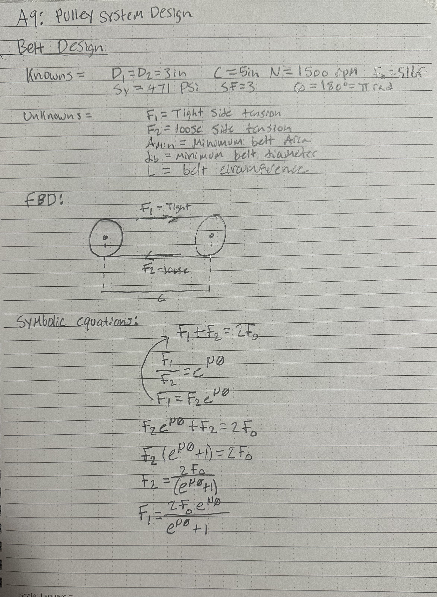

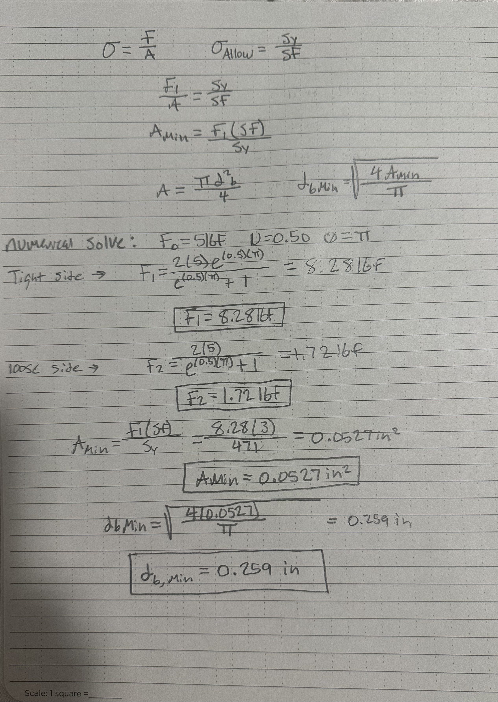

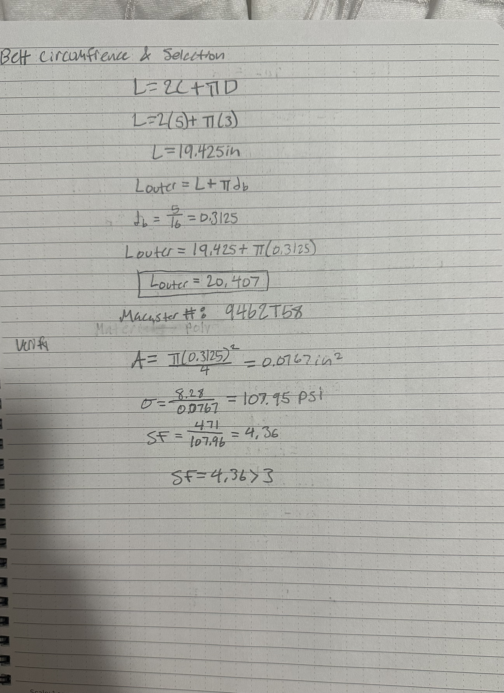

### Shaft Diameter Design
The shafts were designed using 1060 hardened steel and the torque transferred from the belt to the pulleys. Using the tight-side and loose-side belt tensions, I calculated a transmitted torque of 9.84 lbf-in. The minimum shaft diameter was determined using the torsion equations and an allowable shear stress based on a safety factor of 3. 

The calculated minimum shaft diameter was 0.150 inches, so I selected a standard 0.25-inch diameter for both shafts. This resulted in a calculated torsional safety factor of 13.95. The analysis focused on torsional loading and did not include the additional bending stresses caused by belt tension. 

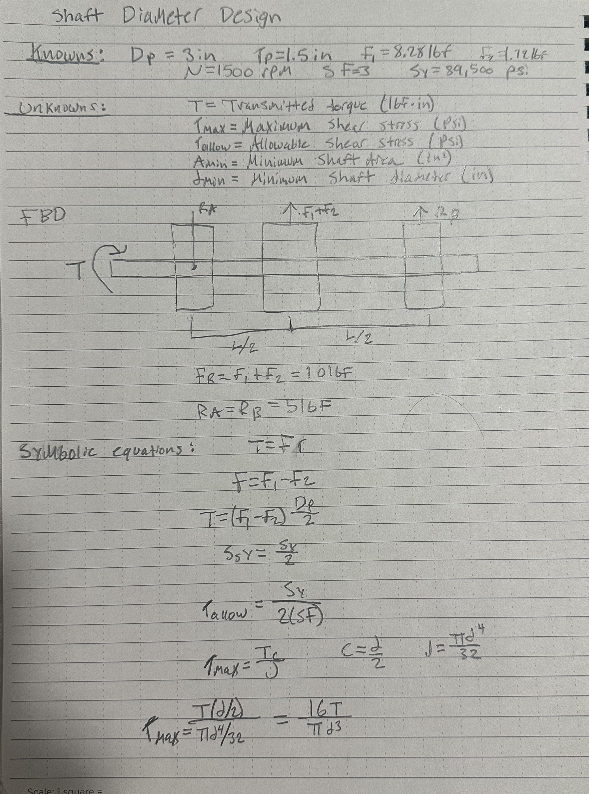

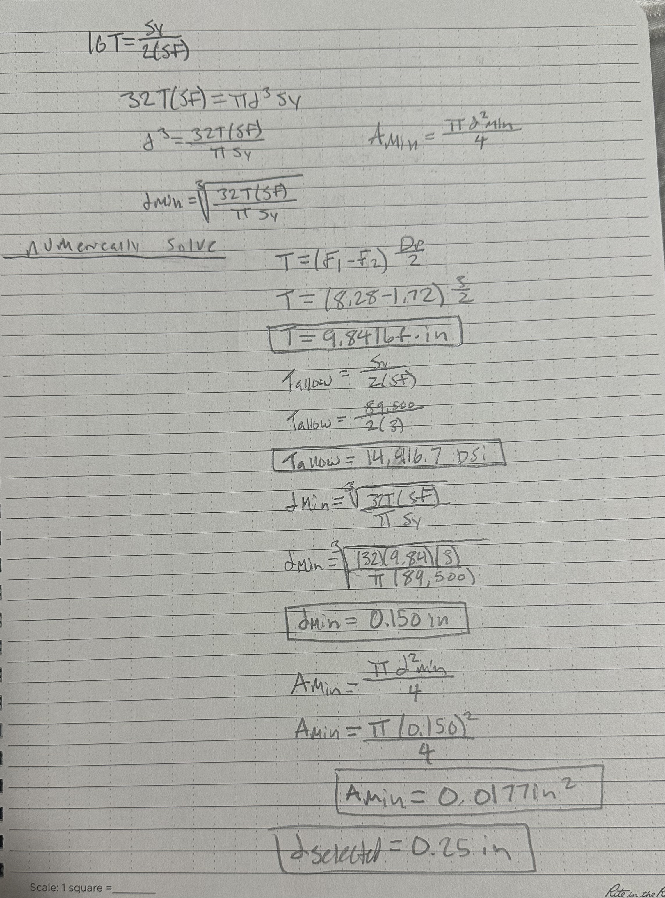

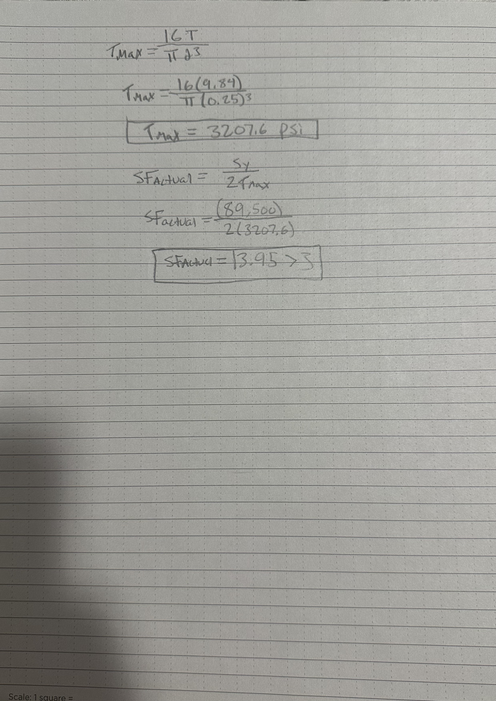

### Journal Bearing Design
The journal bearings were designed to support the two rotating shafts while reducing friction between the shafts and the frame. I used two bearings per shaft, with each bearing supporting a calculated radial load of 5lbf. Using a shaft diameter of 0.25 inches and a bearing length of 0.50 inches, I calculated a bearing pressure of 40 psi, a surface velocity of 98.17 ft/min, and a PV rating of 3,927 psi-ft/min.

I selected porous bronze for the journal bearings using table 4 in Machinery's Handbook. The material has a maximum pressure of 4,500 psi, a maximum velocity of 1,500 ft/min, and an allowable PV rating of 50,000 psi-ft/min. The calculated PV safety margin was 12.73, showing that the selected material operated below the listed limits. 

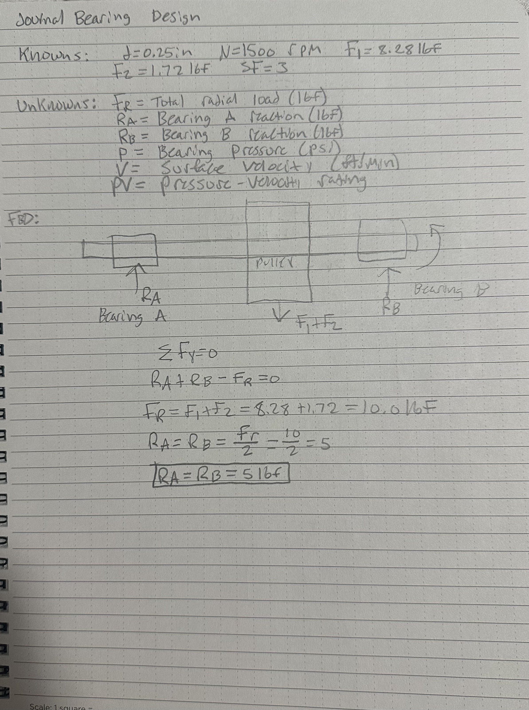

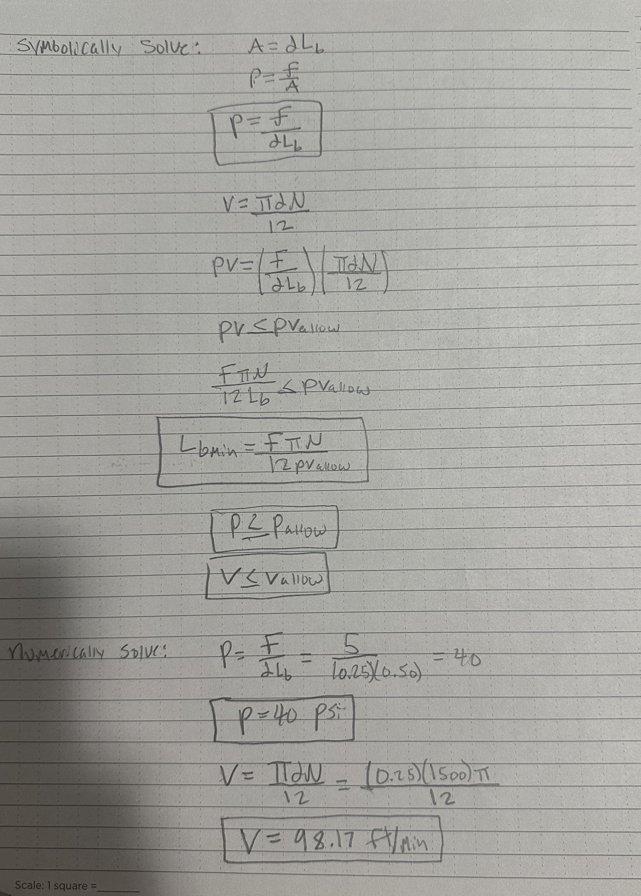

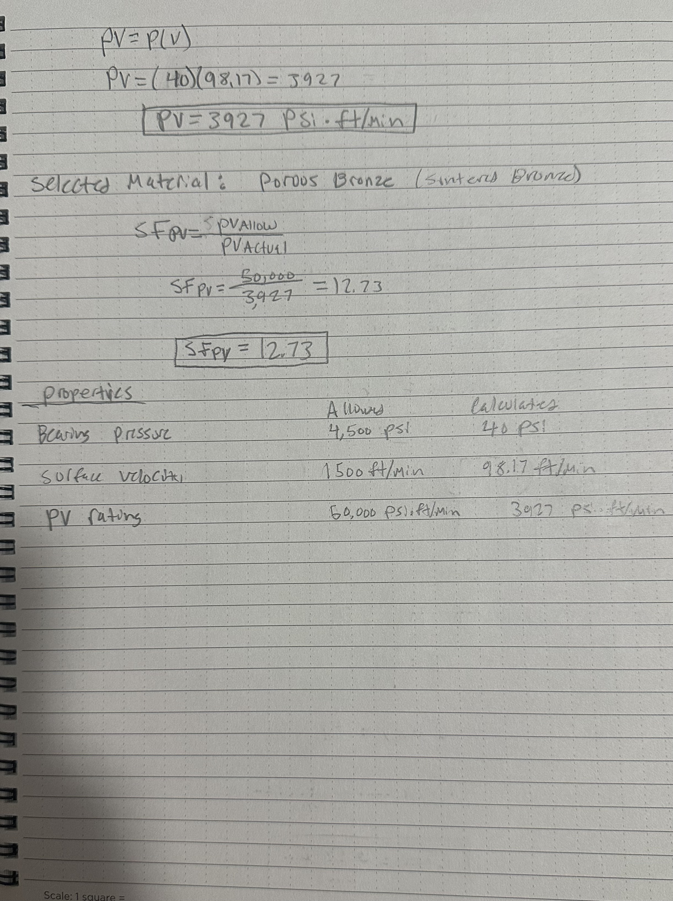

### Frame Design
The supporting frame was designed using 6061-T6 aluminum to hold the two shafts, four journal bearings, and pulleys in position. I selected a base plate measuring 10 x 6 x 0.25 inches with four uprights supports measuring 4 inches tall. The uprights had a rectangular cross section of 0.50 x 0.25 inches with the shafts separated by 5 inches. 

I used static analysis to determine the forces acting on the supports, with each bearing applying a load of 5lbf. Treating the uprights as cantilever beams, I calculated a maximum bending moment of 20 lbf-in and a bending stress of 3,840 psi. Using the yield strength of 6061-T6 aluminum, the calculated safety factor was 10.42, exceeding the minimum requirement of 3. The analysis assumed fixed supports and did not include the strength of the mounting connections. 

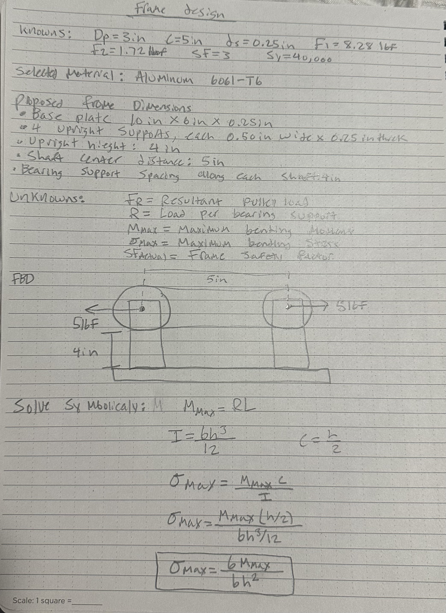

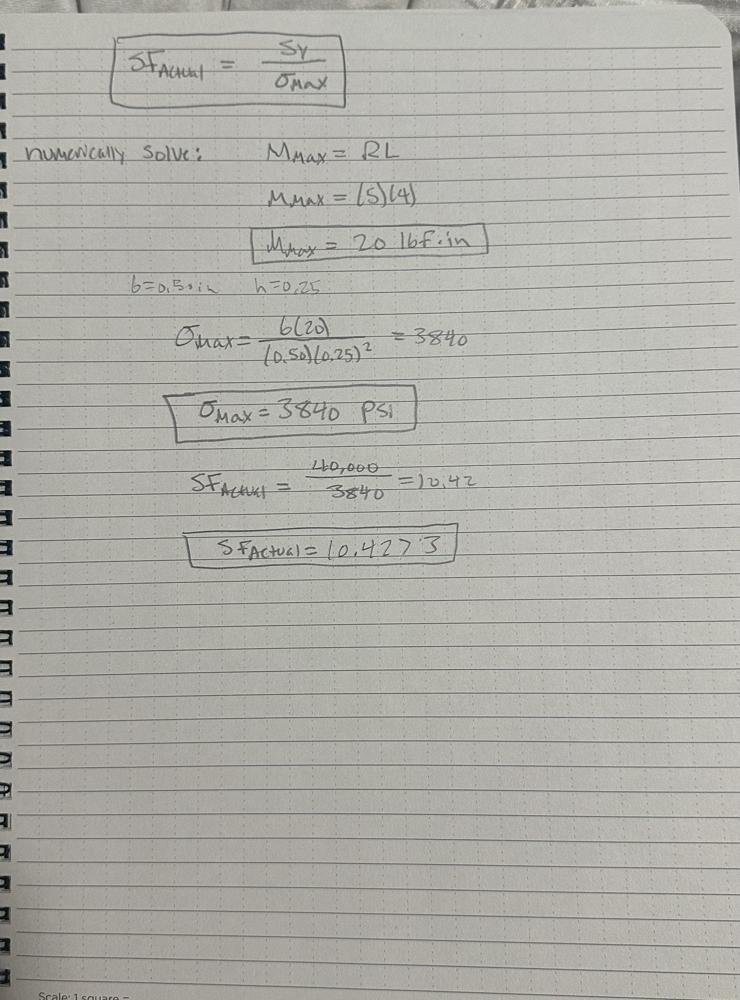

## Decide

### Final Design Summary
The final pulley system uses 3-inch aluminum pulley separated by a center distance of 5 inches and operating at 1500 rpm. A 5/16-inch polyurethane round belt was selected to transfer power between the pulleys. Both shafts were designed using 1060 hardened steel with a diameter of 0.25 inches and supported by four porous bronze journal bearings.

The supporting frame was designed using 6061-T6 aluminum with four upright bearing supports. The calculated safety factor were 4.36 for the belt, 13.95 for the shafts under torsion, and 10.42 for the frame uprights under bending. Each component met the minimum safety factor of 3 for the loading conditions analyzed. The bearing material also satisfied the calculated pressure, velocity, and PV requirements. Additional verification would be needed for shaft bending, mounting connections, and belt preload before manufacturing the system. 

### Design Decisions and Assumptions
Several design decisions were made to keep the pulley system simple while meeting the assignment requirements. I selected the midpoint values for the center distance, rotational speed, and initial belt tension. Aluminum was chosen for the pulleys and frame because of its low weight and sufficient strength, while hardened steel was selected for the shafts because of its higher strength.

During the calculations, I assumed a coefficient of friction of 0.50 between the belt and pulleys. I also assumed the pulleys were centered between their bearings so the radial loads would be distributed equally. The frame supports were treated as fixed cantilever beams for the bending analysis. The belt calculations using the limiting tension before slipping, while the shaft calculations considered torsion only. These assumptions simplified the analysis, but additional testing and calculations would be needed to verify the complete system under operating conditions. 

### Engineering Lessons Learned
Through this assignment, I learned how friction between a belt and pulley affects the amount of torque that can be transferred without slipping. I also learned how the tight-side and loose-side belt tensions can be used to calculate the required belt diameter and the torque acting on the shafts. Another important concept was using pressure, velocity, and PV ratings to select journal bearing materials instead of relying only on material strength. The frame design also demonstrated how bending stress can be calculated using simplified support conditions. Overall, this assignment helped me better understand how the forces acting on one component affect the design requirements of the other components in a mechanical system.

## Communicate

### Mistakes and Corrections
One challenge during the design was determining the correct belt circumference, since the belt's cross-sectional diameter had to be considered when calculating its outer circumference. I also had to account for the difference between the calculated minimum dimensions and the standard sizes available for the belt and shafts. Another limitation was simplifying the shaft and frame loading conditions to perform the stress calculations. These assumptions would need to be examined further because manufacturing the pulley system.

### Time Spent
It took me right around 6 hours to complete this assignment. 

### References

- Machinery's Handbook, 32nd Edition, Table 4, p. 2442 – Application Limits for Sintered Metal and Nonmetallic Bearings.
- McMaster-Carr – Polyurethane Round Belt, Part #9462T58.

### AI Prompts
prompt: Why is the PV rating important 

ChatGpt: The PV rating (Pressure × Velocity) is important because it determines whether a journal bearing can operate safely without excessive friction, heat buildup, or wear.
\[
PV=P\times V
\]

Where:
- P (Pressure): Load applied to the bearing divided by its projected contact area.
- V (Velocity): Surface speed of the rotating shaft.
- PV rating: Maximum allowable pressure–velocity combination for the bearing material under specified operating conditions.
Why it matters
As pressure and velocity increase, friction generates more heat. If the bearing exceeds its allowable PV rating, it can experience:
1. Overheating from excessive friction.
2. Accelerated wear of the bearing surface.
3. Material deformation or loss of lubrication.
4. Bearing failure or seizure of the rotating shaft.
